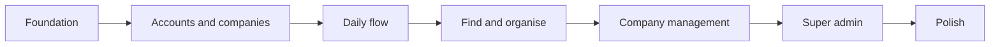

# Tazko build plan

A step-by-step plan to build Tazko as a real app, based on the 13 decisions from the interview and the 14-screen prototype. It is split into 20 small milestones. Each milestone ends in one pull request and one release.

- Prototype (14 screens, plus a Prototype panel with a fake API for scenarios, latency and faults): https://claude.ai/artifact/Np7KMP6A6CyZXwkT5o23Vc
- Last updated: prototype Version 34. It now includes the 7 UX fixes (decisions UX-1 to UX-5 below) and the reload race fix, all checked in Chrome.
- Interactive plan page with checklists: https://claude.ai/artifact/1QfkQMLg4LNxHFmd4pPDEY

## How the work flows

Seven phases made of 20 small milestones. Every milestone ends with a pull request you review, a merge and a release tag, so the app is always in a working state.



## Decisions

These came from the interview and are the source of truth for the build.

| Code | Area | Decision |
|---|---|---|
| G-1 | Goal | Build one practice project and apply what was learned; practise using claude.ai. |
| G-2 | Scope | All 14 screens of the prototype, with sample data seeded into the database. |
| G-3 | Spec (Q-2) | A card can be assigned to an Observer so they can follow it. Observers still cannot edit, move or archive anything. |
| G-4 | Spec (Q-1) | Activity logs everything: comments, column moves, assignments, due dates and description edits. |
| G-5 | Spec (DR-3) | Archiving a project requires typing the project name. |
| G-6 | Permissions | A Super admin opens a company as its Owner. A banner says so, and every change is logged in Activity as made by the Super admin. |
| G-7 | Multi-company | A company switcher sits at the top of the left navigation and remembers the last company used. |
| G-8 | Sample data | 2 companies and 4 users: Linh (Super admin), Minh (Owner of both companies), Hoa (Member) and Khoa (Observer), both in Harbor Logistics. |
| G-9 | Backend | A real backend with an API and a database from the start. |
| G-10 | Stack | Supabase (Postgres and Auth) with a React and Tailwind front end. |
| G-11 | Sign-in | Google plus email and password, so test accounts for each role are easy to create. |
| G-12 | Build setup | The autonomous build runs in Claude Code on the developer's machine, in the dedicated repo `lintran-agilityio/tazko-practice`, apart from any client code. |
| G-13 | Checkpoints | Claude stops after each milestone and opens a pull request for your review. |
| G-14 | Permissions | By default a Super admin sees company-level figures only: the company list, people and counts. Boards and cards can be read only through Open as Owner, which shows a banner and is logged. |
| G-15 | Spec (BR-2) | A project is never deleted by hand. It can only be archived, and an archived project is purged automatically after 30 days. There is no Delete button. |
| G-16 | Permissions | Only Owners create projects. |
| G-17 | Spec (Q-1) | When a description is edited, Activity records who and when, never the text. |
| G-18 | Scope | Usage has no CSV export. |
| UX-1 | List actions | Each board column has a "⋯" menu: Rename, Add card, Move list, Archive list and Delete list. Delete asks for confirmation. Owners only. The menu must stay fully inside its column (a prototype bug clipped it). |
| UX-2 | Add list | A dashed "+ Add list" column ends each board. The name field has focus at once; Enter adds, Esc cancels. Owners only. |
| UX-3 | Checklist | A card has a checklist: check, delete an item with Undo, a "Hide checked items" toggle that shows a count, and a menu to uncheck all or delete the whole checklist (confirmed). |
| UX-4 | Links | A card has a Links list. Long URLs are cut with an ellipsis (domain and start of path), with the full URL in the tooltip and the accessible name. Long text in descriptions and comments wraps. |
| UX-5 | Keyboard and search | Ctrl+Enter (Windows) or ⌘+Enter (Mac) sends a comment or saves a description, with a hint under the field. Members and the card's Assignees picker have a search by name or email. Fields that open on click take focus at once. |
| UX-6 | Quality gate | Nothing is reported as done until the built result was re-run and checked: tests, and the real screens in a browser for UI work. See rule 9. |

## Stack and setup

| Part | Choice |
|---|---|
| Front end | React, TypeScript and Tailwind, built with Vite. Look and feel follow the prototype (Tazko Indigo, Hanken Grotesk and DM Mono). |
| Backend | Supabase: Postgres for data, Auth for sign-in, and Row Level Security to enforce company isolation and roles in the database. |
| Sign-in | Google, and email with password for test accounts. |
| Tests | Vitest for the app, plus database tests that prove one company cannot see another company's data. |
| Where it runs | Claude Code on the developer's machine, in the dedicated tazko-practice repo. |

Why Row Level Security matters here: the rule that each company sees only its own boards is enforced by the database itself, so a bug in the screens cannot leak data between companies.

## Data model

| Table | Main columns | Notes |
|---|---|---|
| companies | id, name, created_at | A tenant. Every board, card and member belongs to exactly one company (T-1). |
| profiles | id (the auth user), display_name, is_super_admin, last_company_id | One row per signed-in person. last_company_id powers the company switcher (G-7). |
| memberships | company_id, user_id, role (owner, member, observer) | Links people to companies. Unique per company and person. |
| boards | id, company_id, name, description, archived_at | Called a project in settings (T-2). archived_at starts the 30-day restore window (BR-2). |
| columns | id, board_id, name, position | The columns of a board. |
| cards | id, company_id, board_id, column_id, title, description, due_date, position | A card lives on exactly one board and in one column; moving it changes column_id only (BR-1). |
| card_assignees | card_id, user_id | Any role can be assigned, Observers included (G-3). |
| checklist_items | id, card_id, text, done, position | The card checklist (UX-3). Same write rules as the card. |
| card_links | id, card_id, url, position | Links on a card (UX-4). The full URL is stored; shortening is done on screen only. |
| labels, card_labels | labels(id, company_id, name, color); card_labels(card_id, label_id) | Labels belong to a company and are shared by its boards. |
| comments | id, card_id, author_id, body, created_at | Shown in Activity. |
| activity | id, company_id, card_id, actor_id, acting_as_super_admin, type, payload, created_at | Written by database triggers so nothing can skip it (G-4). acting_as_super_admin records the Open as Owner case (G-6). A description edit is an event with no text (G-17). |
| notifications | id, user_id, activity_id, read_at | Generated from activity for assignments, comments and due dates. |

### Who can do what

| Action | Who can do it |
|---|---|
| Read | Anyone who belongs to the company, in any role. A Super admin sees company-level figures only, and reads boards and cards only through Open as Owner (G-14). |
| Create, edit and move cards, comment | Owners and Members of that company. Observers cannot (BR-3). |
| Manage labels, members and project settings | Owners of that company. Members can still apply existing labels to cards. |
| Create a project | Owners only (G-16). |
| Archive and restore a project | Owners only. An archived project is read-only, and it is purged automatically after 30 days (BR-2, G-15). |
| Companies, usage, Open as Owner | Super admins only. Owners and Members never see this area. |

## Release roadmap

Each row is one pull request and one release.

| Milestone | Name | Screens | Depends on | Release |
|---|---|---|---|---|
| M1 | Scaffold and app shell | Placeholders for all 14 | None | v0.1.0 |
| M2 | Database, roles and isolation | None (database only) | M1 | v0.2.0 |
| M3 | Sign in with email | Sign in | M2 | v0.3.0 |
| M4 | Company switcher and Profile | Profile | M3 | v0.4.0 |
| M5 | Sign in with Google | Sign in | M3 | v0.5.0 |
| M6 | Boards on screen | Home, Board | M4 | v0.6.0 |
| M7 | Create and move cards | Board | M6 | v0.7.0 |
| M8 | Card detail | Card detail | M7 | v0.8.0 |
| M9 | Comments and Activity | Card detail | M8 | v0.9.0 |
| M10 | Labels | Labels | M8 | v0.10.0 |
| M11 | Board as list | Board as list | M7 | v0.11.0 |
| M12 | Search | Search | M7 | v0.12.0 |
| M13 | Notifications | Notifications | M9 | v0.13.0 |
| M14 | Members and invites | Members | M4 | v0.14.0 |
| M15 | Create and edit projects | Project settings | M7 | v0.15.0 |
| M16 | Archive project | Project settings | M15 | v0.16.0 |
| M17 | Companies and Company detail | Companies, Company detail | M4 | v0.17.0 |
| M18 | Open as Owner | Company detail, banner on every screen | M9, M17 | v0.18.0 |
| M19 | Usage | Usage | M9, M17 | v0.19.0 |
| M20 | Polish and hand-off | All 14 screens | M1 to M19 | v1.0.0 |

## Milestones

### Phase 1: Foundation

#### M1: Scaffold and app shell

- **Screens:** Placeholders for all 14
- **Depends on:** None
- **Release:** `v0.1.0`
- **Models:** Sonnet builds, Haiku does scaffolding

- [ ] Create the Vite, React, TypeScript and Tailwind project in the sandbox repo.
- [ ] Add lint, typecheck and Vitest, plus a GitHub Actions workflow that runs all three.
- [ ] Build the app shell: side navigation and a placeholder route for each of the 14 screens. At phone width the navigation becomes a drawer: a button opens it, Esc and choosing a page close it.
- [ ] Add the Tazko Indigo design tokens: colours, Hanken Grotesk and DM Mono.

**Done when:** npm run dev shows the shell, every route is reachable, and CI is green.

### Phase 2: Accounts and companies

#### M2: Database, roles and isolation

- **Screens:** None (database only)
- **Depends on:** M1
- **Release:** `v0.2.0`
- **Models:** Opus reviews the schema first, Sonnet builds, Haiku writes seed data

- [ ] Start the local Supabase stack with supabase init and supabase start; add a migrations folder and an .env.example.
- [ ] Migrations for companies, profiles and memberships, plus the role type and the is_super_admin flag.
- [ ] Row Level Security helpers that answer: is this person a member, what is their role, are they a Super admin.
- [ ] Let a Super admin read company-level tables (companies and memberships) only. Later tables stay closed to a Super admin outside Open as Owner (G-14).
- [ ] Block a person from changing their own is_super_admin flag or role, in the database.
- [ ] Seed the 2 companies and 4 users from G-8 with one command.
- [ ] Tests that prove isolation: one company cannot read another company’s rows, an Observer cannot write, and nobody can promote themselves.

**Done when:** The seed loads with one command and every isolation test passes.

#### M3: Sign in with email

- **Screens:** Sign in
- **Depends on:** M2
- **Release:** `v0.3.0`
- **Models:** Sonnet builds

- [ ] Sign in screen with email and password, and a sign out action.
- [ ] Create a profile row automatically when someone signs up.
- [ ] Redirect signed-out visitors to Sign in from every other route.
- [ ] Show the signed-in person and their role chip at the bottom of the left navigation.

**Done when:** You can sign in as each seed user and sign out again.

#### M4: Company switcher and Profile

- **Screens:** Profile
- **Depends on:** M3
- **Release:** `v0.4.0`
- **Models:** Sonnet builds

- [ ] Company switcher at the top of the left navigation (G-7), remembering the last company used.
- [ ] Show only the navigation items a role may use: Owners also see Members, Labels and Project settings.
- [ ] Profile screen: edit display name, list your companies and roles, sign out.

**Done when:** Minh switches between both companies without signing out, and the choice is remembered.

#### M5: Sign in with Google

- **Screens:** Sign in
- **Depends on:** M3
- **Release:** `v0.5.0`
- **Models:** Sonnet builds

- [ ] Configure the Google provider locally: client ID in the config file, secret in the environment.
- [ ] Add Continue with Google as the single primary action on Sign in.
- [ ] Handle the callback and send the person to Home.
- [ ] Document the Google setup in the README.

**Done when:** A Google account can sign in and gets a profile row. If the Google credential is not ready, skip this milestone for now; nothing after it depends on it.

### Phase 3: Daily flow

#### M6: Boards on screen

- **Screens:** Home, Board
- **Depends on:** M4
- **Release:** `v0.6.0`
- **Models:** Sonnet builds, Haiku writes sample boards

- [ ] Migrations for boards, columns and cards, and seed the four sample boards from the prototype.
- [ ] Home: recent boards as tiles first, then what needs attention; tiles scroll sideways under 600px (DR-4).
- [ ] Board screen: columns and cards, read-only, with tabs to switch between boards.
- [ ] Empty state for a board with no cards.

- [ ] Seed one board with a few cards for Northwind Foods too, so isolation tests have data on both sides (G-8).
- [ ] Tests: a user sees only their own company’s boards, and a Super admin sees no boards or cards (G-14).

**Done when:** Every role sees only the current company’s boards, a Super admin sees none, and the tabs switch boards.

#### M7: Create and move cards

- **Screens:** Board
- **Depends on:** M6
- **Release:** `v0.7.0`
- **Models:** Sonnet builds

- [ ] Settle open question Q3 (how cards move), then build it.
- [ ] Settle open question Q5 for cards (archive or delete), then build what it decides.
- [ ] Add card as the single primary action on Board.
- [ ] Moving a card changes its column only, never copies it (BR-1).
- [ ] Hide create and move controls from Observers, and block the same writes in the database (BR-3).
- [ ] Move optimistically: the card moves at once; if the API fails it goes back to its column with a message, and Retry (or Sign in again for a 401).
- [ ] Ignore replies that belong to an older load, so a reload during a save cannot corrupt the "saving" count or roll back the new board.

**Done when:** Hoa can add and move cards; Khoa sees no controls and the database refuses his writes. A reload while a move is saving leaves the board and the saving indicator correct.

#### M8: Card detail

- **Screens:** Card detail
- **Depends on:** M7
- **Release:** `v0.8.0`
- **Models:** Sonnet builds

- [ ] Card page with title, description editing, due date and column, and a link back to the board.
- [ ] Assignees, Observers included, with a note that Observers follow the card but cannot edit it (G-3).
- [ ] Observers see the page read-only.
- [ ] Checklist (UX-3): migration for checklist_items, check and delete with Undo, hide checked items, and the checklist menu.
- [ ] Links (UX-4): migration for card_links, add and remove, long URLs cut with an ellipsis.
- [ ] Assignees picker with search by name or email (UX-5).
- [ ] Description editing takes focus at once and saves with Ctrl+Enter or ⌘+Enter (UX-5).

**Done when:** Hoa can edit a card, use its checklist and links; Khoa can be assigned to it but cannot change anything. A 200-character URL does not stretch the page.

#### M9: Comments and Activity

- **Screens:** Card detail
- **Depends on:** M8
- **Release:** `v0.9.0`
- **Models:** Opus reviews the trigger design first, Sonnet builds

- [ ] Comments table and a comment box on Card detail; Ctrl+Enter or ⌘+Enter sends, with the matching hint (UX-5).
- [ ] Activity table plus database triggers for comments, moves, assignments, due dates and description edits (G-4). A description edit records who and when, never the text (G-17).
- [ ] Add the acting_as_super_admin column now, ready for M18 (G-6).
- [ ] Activity list on Card detail showing who did what and when, with times in the mono face.

**Done when:** Every action from M7 and M8 appears in Activity.

#### M10: Labels

- **Screens:** Labels
- **Depends on:** M8
- **Release:** `v0.10.0`
- **Models:** Sonnet builds

- [ ] Migrations for labels and card_labels.
- [ ] Labels screen for Owners: create, edit and delete.
- [ ] Members and Owners can apply labels on Card detail; label chips show on board cards.

**Done when:** An Owner manages labels, and labels show on cards across the company’s boards.

### Phase 4: Find and organise

#### M11: Board as list

- **Screens:** Board as list
- **Depends on:** M7
- **Release:** `v0.11.0`
- **Models:** Sonnet builds

- [ ] List view of the same cards with sortable columns.
- [ ] Board and List toggle on both views.

**Done when:** The list shows exactly the cards the board shows, and sorting works.

#### M12: Search

- **Screens:** Search
- **Depends on:** M7
- **Release:** `v0.12.0`
- **Models:** Sonnet builds

- [ ] Search across card titles and board names in the current company only.
- [ ] Results table showing board and column.
- [ ] A test proving search never returns another company’s data.

**Done when:** Searching for a word finds matching cards, and the isolation test passes.

#### M13: Notifications

- **Screens:** Notifications
- **Depends on:** M9
- **Release:** `v0.13.0`
- **Models:** Sonnet builds

- [ ] Settle open question Q4 (in-app only or real email).
- [ ] Notifications table filled from Activity for assignments and comments; work out due tomorrow when the list loads.
- [ ] Notifications screen with All and Unread, and a Mark all as read action.
- [ ] Unread count in the left navigation.

**Done when:** Being assigned a card or getting a comment creates a notification that can be marked as read.

### Phase 5: Company management

#### M14: Members and invites

- **Screens:** Members
- **Depends on:** M4
- **Release:** `v0.14.0`
- **Models:** Sonnet builds

- [ ] Members list with role chips and last seen in the mono face (DR-2).
- [ ] Change a member’s role, for Owners only.
- [ ] Invite someone by email, shown as a pending row until accepted.
- [ ] Search by name or email, with a Clear button, a result count and an empty state; pending invites are searchable by email (UX-5).

**Done when:** An Owner can invite someone and change their role; Members and Observers cannot reach the screen. Searching narrows the list and shows "No members match" when nothing fits.

#### M15: Create and edit projects

- **Screens:** Project settings
- **Depends on:** M7
- **Release:** `v0.15.0`
- **Models:** Sonnet builds

- [ ] Settle open question Q5 (cards and columns that are removed).
- [ ] New project action on the Boards page, for Owners only (G-16). It creates a project with the columns Backlog, In progress, Review and Done.
- [ ] Edit a project’s name and description.
- [ ] Add, rename and reorder columns.
- [ ] Column menu on the Board (UX-1): Rename, Add card, Move list, Archive list and Delete list with confirmation; the menu stays inside its column.
- [ ] "+ Add list" column at the end of the Board, focused name field, Enter to add and Esc to cancel (UX-2).
- [ ] Owners only.

**Done when:** Changes show up on the board straight away, and an Owner can add, rename and delete a list from the Board itself.

#### M16: Archive project

- **Screens:** Project settings
- **Depends on:** M15
- **Release:** `v0.16.0`
- **Models:** Sonnet builds, Haiku does the shared confirm component

- [ ] Settle open question Q2 (how the 30-day purge runs).
- [ ] A shared confirm-by-name component, used for archiving (G-5).
- [ ] Archive makes a project read-only and restorable for 30 days; after that it is purged (BR-2).
- [ ] No Delete button. An archived project is purged automatically after 30 days (G-15).

**Done when:** Archiving needs the typed name, an archived project restores within 30 days, and only Owners can do it.

### Phase 6: Super admin

#### M17: Companies and Company detail

- **Screens:** Companies, Company detail
- **Depends on:** M4
- **Release:** `v0.17.0`
- **Models:** Sonnet builds

- [ ] Companies screen: list companies and create a new one.
- [ ] Company detail: people, counts and a link back to the list.
- [ ] Make sure Owners and Members can never see or reach the Super admin area.

**Done when:** A Super admin sees both companies and their people; nobody else can open these screens.

#### M18: Open as Owner

- **Screens:** Company detail, banner on every screen
- **Depends on:** M9, M17
- **Release:** `v0.18.0`
- **Models:** Opus reviews the approach first, Sonnet builds

- [ ] Settle open question Q1 (how Open as Owner works technically).
- [ ] Open as Owner action on Company detail.
- [ ] Banner on every screen while it is active: Viewing as Owner of the company (G-6).
- [ ] Set acting_as_super_admin on every change made in this mode, and show it in Activity.
- [ ] Exit action that returns to Companies.
- [ ] Test: outside Open as Owner a Super admin still cannot read boards, cards or Activity (G-14).

**Done when:** A Super admin opens either company as Owner, the banner shows, and Activity shows who really acted.

#### M19: Usage

- **Screens:** Usage
- **Depends on:** M9, M17
- **Release:** `v0.19.0`
- **Models:** Sonnet builds

- [ ] Compute active members per week and totals per company through a database function that returns counts only, so a Super admin never reads Activity rows (G-14).
- [ ] Usage screen with a chart of active members per week and a table of totals.
- [ ] Super admins only. No CSV export (G-18).

**Done when:** The numbers on Usage match the Activity records, and no Activity row is readable by a Super admin.

### Phase 7: Polish

#### M20: Polish and hand-off

- **Screens:** All 14 screens
- **Depends on:** M1 to M19
- **Release:** `v1.0.0`
- **Models:** Sonnet builds, Haiku writes docs

- [ ] Check every screen at phone width and fix layout problems.
- [ ] Accessibility pass: visible focus, labels on every input, and text contrast.
- [ ] Empty, loading and error states for every list and form.
- [ ] Make every change optimistic with undo on failure, and add clear error, session-expired and offline states.
- [ ] Test the states against the prototype panel's matrix: 6 scenarios (Normal, New company, Observer, Super admin, Big board, Archived), 4 latencies and 7 faults (none, Offline, Server error, Session expired, Forbidden, Not found, Conflict). Every combination must end in the right screen with no errors.
- [ ] Open the real app in a browser and run each menu, form and shortcut from UX-1 to UX-5 at desktop and phone width.
- [ ] Write the README: setup, seed accounts, how to run the tests.
- [ ] Compare each screen with the prototype and list any differences in the final pull request.

**Done when:** All 14 screens match the prototype, the README works from a clean clone, and every test passes.

### Which milestone builds which screen

| Screen | Built in |
|---|---|
| Sign in | M3, M5 |
| Profile | M4 |
| Home | M6 |
| Board | M6, M7 |
| Card detail | M8, M9 |
| Board as list | M11 |
| Search | M12 |
| Notifications | M13 |
| Members | M14 |
| Labels | M10 |
| Project settings | M15, M16 |
| Companies | M17 |
| Company detail | M17, M18 |
| Usage | M19 |

## How to release and manage

1. One milestone is one branch, one pull request and one release tag. The tag is named in the milestone, for example v0.7.0.
2. The dev and main branches must always work: merge only when typecheck, lint and all tests pass.
3. After each merge, add a line to CHANGELOG.md saying what changed, so the history is clear at a glance.
4. Keep milestones small. If one grows past about five tasks, or needs more than one group of screens, split it before building.
5. To track work on GitHub, create a GitHub milestone for each M and an issue for each task, or simply use the checklists on this page.
6. Branches: dev is the integration branch and main is the release branch. Cut each milestone branch from dev and open the pull request back into dev. After the merge, merge dev into main and create the release tag on main.

## Models and cost

To keep usage cost down, the expensive model advises and the cheaper ones do the work.

| Role | Model | Used for |
|---|---|---|
| Advisor | Opus | Reviews this plan, the schema and the access rules before M1 and before M5. Never writes code. |
| Builder | Sonnet | All feature code, database migrations and tests. |
| Mechanical | Haiku | Seed data, renames, formatting, boilerplate and small documentation fixes. |

## Rules for the autonomous build

1. Work only inside this repository. Never touch client code.
2. One milestone is one branch, one pull request and one release. Name the branch like m7-create-and-move-cards.
3. Before starting a milestone, re-read it and the decisions G-1 to G-18 and UX-1 to UX-6. After finishing, run typecheck, lint and every test, including the isolation tests.
4. The pull request lists what was built, the assumptions made and anything left unfinished. Then stop and wait for review.
5. Once I merge, tag the release named in the milestone and add a line to CHANGELOG.md. Then wait for me to say go before starting the next milestone.
6. If the plan is silent or two rules conflict, add the question to the open questions list and ask. Do not guess.
7. Write all code, comments, documentation and commit messages in English.
8. Never commit secrets. Keep only an .env.example in the repo.
9. Before saying a milestone is done, re-run and check the real result: typecheck, lint and tests, and for any screen change open it in a browser and use it (menus, forms, keyboard, error cases). Write what was checked and what it showed in the pull request. If something could not be checked, say why and what is needed; never end with "not tested".
10. Follow the Safety section: the trust ladder decides how much runs unattended, and the stop conditions always apply.

## Safety

Three built-in lessons for the autonomous build. They apply to every milestone.

### 1. Review the plan like code

Read this plan the way you would read a pull request before running anything from it.

- For each milestone, list the commands it implies, the packages it installs and the places it writes files. Anything surprising is a bug in the plan.
- Check that every task matches a decision (G-1 to G-18) and a rule in this file.
- Start Claude Code in plan mode first, so it proposes the steps and you approve them before any file changes.
- Ask the advisor model (Opus) to review the plan or a risky milestone before it is built. It reviews and never writes code.

### 2. Trust ladder

Give Claude more freedom one rung at a time. Move up only when the previous rung finished without an incident.

| Rung | Milestones | How it runs |
|---|---|---|
| 1. Supervised | M1 | You approve every command and read every diff. No chained or batched commands. |
| 2. Semi-supervised | M2 to M5 | Claude edits code freely. It asks first for migrations, package installs, and auth or Supabase configuration. |
| 3. Autonomous | M6 to M19 | Claude runs a whole milestone and stops at each pull request. |
| 4. Full run | After rung 3 | Claude chains milestones with no wait for review. The stop conditions below still apply. |

An incident is any stop condition that fired unexpectedly, a secret that reached a tracked file, or a change outside this repository. After an incident, go back one rung.

### 3. Stop conditions

Claude stops and asks before doing any of these, at every rung.

| Group | Stop when |
|---|---|
| Secrets | About to read, write or print a `.env` file, a Supabase `service_role` key, a Google client secret or any token. About to commit a file that holds a secret. |
| Machine changes | About to install a global package, change PATH or a shell profile, change Docker settings, use `sudo`, or write or delete a file outside this repository. |
| Risky git | About to force push, delete a branch, rewrite history, or push directly to `main`. |
| Surprises | A command fails twice in a row, a test is deleted or skipped to make the suite pass, or the plan and a decision disagree. |

## Prototype panel

The prototype has a panel artboard (`Prototype panel`) that drives one fake API. It is the reference for how every screen must behave when data is slow, empty, restricted or failing. Each milestone that builds a screen with a list or a form should show these states.

| Group | Options |
|---|---|
| Scenarios (6) | Normal day, New company (no cards), Observer view, Super admin opens as Owner, Big board (24 cards), Archived project |
| Latency (4) | Instant (0 ms), Fast (300 ms), Slow (1500 ms), Very slow (4000 ms) |
| Faults (6) | Offline (status 0), Server error (500), Session expired (401), Forbidden (403, row level security), Not found (404), Conflict (409 when moving a card) |

### The 6 scenarios in detail

| Scenario | Who | Data | What to try | Expected |
|---|---|---|---|---|
| Normal day | Minh, Owner of Harbor Logistics | 4 columns, 7 cards | Move "Add invoice export"; move again with the Conflict fault; reload with Slow latency | The first move shows at once and is saved (PATCH 200). With Conflict the card moves, then jumps back with a red banner and Retry. Slow shows a skeleton for 1.5 s |
| New company | Minh, Owner of Northwind Foods | 4 columns, 0 cards | Reload; reload with Server error; reload with No fault | "No cards yet" (GET 200), then a 500 error screen with Try again, then "No cards yet" again |
| Observer view | Khoa, Observer | Same 7 cards | Look for Move buttons and PATCH requests | Banner says Observers cannot change anything; no Move buttons; the API would answer 403 (G-3) |
| Super admin opens as Owner | Linh, Super admin | Same 7 cards | Read the banner; move a card | Banner says she views the company as its Owner and changes are logged; the move works (G-6, G-14) |
| Big board | Minh, Owner | 4 columns, 24 cards | Scroll; reload with Very slow latency; move a card | Counts of 6 per column and a layout that holds; 4 s skeleton; counts become 5 and 7 after the move |
| Archived project | Minh, Owner | Same 7 cards | Read the banner; look for Move buttons | Banner says archived and read-only; no Move buttons; the API would answer 403 (G-15) |

The request log clears when the scenario changes, so it only shows requests for the current scenario.

- Every change is optimistic: the card moves on screen at once and a "Saving..." note shows while the request is pending. If the request fails, the card goes back to its original column, a message explains why, and the user gets Retry (or Sign in again when the session has expired).
- Loading the board has its own clear states: skeleton while loading, "You are offline" with Try again, "Your session has expired" with Sign in again, and a generic error with the status code.
- All requests go through a single function, `api(method, path, body)`. It waits for the latency, applies the fault, checks the role, and writes a line to the request log.
- Observers and archived projects get 403 on writes, matching the access rules above.
- In the real app, the same states are covered by tests that stub the data layer with these scenarios, latencies and faults.

## Open questions

Settle each one before the milestone that needs it. Out of scope for now: real-time collaboration, file uploads and card cover images, the weekly digest email, the board background picker, and a mobile app. Card titles such as "Weekly digest email" in the prototype are sample data, not features.

|  | Question | Decide |
|---|---|---|
| Q1 | How should Open as Owner work technically? Recommended: a session flag that the database policies check, so no extra membership row is written. | Before M18 |
| Q2 | How is the 30-day purge of archived projects run: a scheduled database job or a scheduled function? | Before M16 |
| Q3 | How do people move cards: a menu, drag and drop, or both? Recommended: a menu first because it is easier to make accessible. | Before M7 |
| Q4 | Do invites and notifications send real email, or stay in the app only? Recommended: in the app only for this practice. | Before M13 |
| Q5 | Can cards be removed, and what happens to a column that still has cards? Recommended: cards are archived rather than deleted, and a column that still has cards cannot be deleted. | Before M7 (cards), M15 (columns) |
| Q6 | Which router for the 14 screens? Decided: React Router 7. | Decided |
| Q7 | Self-signup or invite-only? What does a signed-in user with no company see? Recommended: invite-only, with a "No company yet" empty state. | Before M3 |
| Q8 | How do database tests run locally and in CI? Recommended: Vitest plus a pg client against `supabase start`; CI starts Supabase. | Before M2 |
| Q9 | Self-host the fonts or use the Google Fonts link? Decided: self-host with `@fontsource`. | Decided |
| Q10 | May a Super admin read the display name of a company's members (G-14 says "people")? Recommended: yes, through a view with display name only, not the full profiles table. | Before M2 |
| Q11 | Which branch is the base for milestones: `main` or `dev`? Decided: `dev` is the integration branch and is merged into `main` for each release (see "How to release and manage"). | Decided |
| Q12 | What are the URLs of the 14 screens? Decided: boards and cards are addressed by their database id (UUID), never by name. `/sign-in`, `/` (Home), `/boards/:boardId`, `/boards/:boardId/list`, `/cards/:cardId`, `/search`, `/notifications`, `/members`, `/labels`, `/settings/project`, `/profile`, `/companies`, `/companies/:companyId`, `/usage`. | Decided |

## Before the build

- [x] Use the dedicated repo `lintran-agilityio/tazko-practice` (practice only, no client code).
- [x] Install Claude Code on your machine.
- [ ] Review this plan like code (see Safety) before the first run, and start Claude Code in plan mode.
- [ ] Install Docker and Node.js 20 or newer, so the local Supabase stack can run.
- [ ] Prepare a Google sign-in credential for Supabase Auth. It is only needed for M5, so it can wait.
- [ ] Save the prototype source and tokens into design/, and save this plan as PLAN.md in the repo.

## Kickoff prompt for Claude Code

Paste this into Claude Code from the root of this repository.

```text
You are building Tazko, a kanban work tracker that one group runs for several of its companies.

Source of truth: PLAN.md in this repository (20 small milestones, each one pull request and one release). Visual reference: the prototype in design/ (see design/README.md; PLAN.md wins on conflict).

Work one milestone at a time, starting with M1. For each milestone:
1. Read the milestone and the decisions G-1 to G-18 and UX-1 to UX-6.
2. Create a branch named mN-short-name from dev.
3. Implement the tasks.
4. Run typecheck, lint and all tests, including the isolation tests. For screen changes, also open the app in a browser and use the feature, including error cases.
5. Open a pull request into dev that lists what you built, the assumptions you made and anything unfinished.
6. Stop and wait for my review.
7. After I merge, tag the release named in the milestone and add a line to CHANGELOG.md.
8. Do not start the next milestone until I say so.

Rules:
- Work only in this repository.
- Write all code, comments, docs and commit messages in English.
- Never commit secrets.
- Follow the trust ladder in the Safety section of PLAN.md. In M1, I approve every command: do not chain or batch commands.
- Stop and ask me before: touching secrets (.env files, keys, tokens); changing my machine (global installs, PATH, shell profile, Docker settings, sudo, files outside this repository); risky git (force push, deleting branches, pushing to main); or when a command fails twice in a row.
- If the plan is silent or two rules conflict, add the question to the open questions list and ask me instead of guessing.
- Follow the model split in PLAN.md: Opus advises, Sonnet writes code, Haiku handles mechanical work.
```
