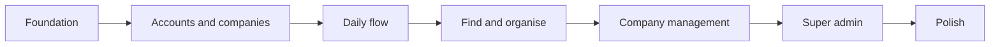

# Tazko build plan

A step-by-step plan to build Tazko as a real app, based on the decisions from the interview and the planning reviews (G-1 to G-21) and the 15-screen prototype (14 screens plus Accept invite). It is split into 31 small milestones. The ones with a letter (M2b, M3b, M6b, M7b, M8b, M14b, M14c, M15b, M18b, M20b, M20c) are follow-ups that keep each pull request small. Each milestone ends in one pull request and one release.

- Prototype (15 screens, plus a Prototype panel with a fake API for scenarios, latency and faults): https://claude.ai/artifact/Np7KMP6A6CyZXwkT5o23Vc
- Last updated: prototype Version 35 source is saved in `design/` (Accept invite, the G-20 Sign in states, the 400 fault, and the Archived project scenario reworded for G-19). The live artifact is still Version 34 until the files are loaded into Design again. Version 34 added the UX fixes (UX-1 to UX-5) and the reload race fix, checked in Chrome.
- Delivery plan (milestones, owner gates, API surface, questions, risks): https://claude.ai/artifact/F4swGuTCXtSmSV7SnEk9rE
- Blueprint (decisions, findings, requirements, tests, readiness): https://claude.ai/artifact/FHWvj1NtKMZX2nF22qfJeK

## How the work flows

Seven phases made of 31 small milestones. Every milestone ends with a pull request you review, a merge and a release tag, so the app is always in a working state.



## Decisions

These came from the interview and are the source of truth for the build.

| Code | Area | Decision |
|---|---|---|
| G-1 | Goal | Build one practice project and apply what was learned; practise using claude.ai. |
| G-2 | Scope | All 15 screens of the prototype (14 plus Accept invite), with sample data seeded into the database. |
| G-3 | Spec (Q-2) | A card can be assigned to an Observer so they can follow it. Observers still cannot edit, move or archive anything. |
| G-4 | Spec (Q-1) | Activity logs everything: comments, column moves, assignments, due dates and description edits. |
| G-5 | Spec (DR-3) | Archiving a project requires typing the project name. |
| G-6 | Permissions | A Super admin opens a company as its Owner. A banner says so, and every change is logged in Activity as made by the Super admin. |
| G-7 | Multi-company | A company switcher sits at the top of the left navigation and remembers the last company used. |
| G-8 | Sample data | 2 companies and 4 users: Linh (Super admin), Minh (Owner of both companies), Hoa (Member) and Khoa (Observer), both in Harbor Logistics. |
| G-9 | Backend | A real backend with an API and a database from the start. |
| G-10 | Stack | Supabase (Postgres and Auth) with a React and Tailwind front end. |
| G-11 | Sign-in | Google plus email and password. Accounts come from the seed or an invite, so test accounts for each role are easy to create (signup is off, Q13). |
| G-12 | Build setup | The autonomous build runs in Claude Code on the developer's machine, in the dedicated repo `lintran-agilityio/tazko-practice`, apart from any client code. |
| G-13 | Checkpoints | Claude stops after each milestone and opens a pull request for your review. |
| G-14 | Permissions | By default a Super admin sees company-level figures only: the company list, people and counts. Boards and cards can be read only through Open as Owner, which shows a banner and is logged. |
| G-15 | Spec (BR-2) | A project is never deleted. It can only be archived. An Owner can restore it for 30 days; after that it is locked (the app cannot restore it) and it stays in the database (G-19). There is no Delete button and no purge job. |
| G-16 | Permissions | Only Owners create projects. |
| G-17 | Spec (Q-1) | When a description is edited, Activity records who and when, never the text. |
| G-18 | Scope | Usage has no CSV export. |
| G-19 | Data | Nothing is ever permanently deleted in the database. Every table that people can remove rows from has `archived_at` and `archived_by`. DELETE is revoked from all app roles, and reads return active rows only. Archived rows are listed and restored through Owner-only RPCs. In this plan "delete" for labels, checklist items, links, lists and members means archive. |
| G-20 | Permissions | People can sign in, and be invited, only with an email address on an allowed company domain. Personal addresses (Gmail and the like) are refused for Google, for email sign-in and for invites. There is one allow-list for the whole group, kept in the database (`allowed_domains`, soft delete) and loaded by the seed from the `ALLOWED_EMAIL_DOMAINS` environment variable. The real domain is set in the local environment and is not written in the repo. The database refuses to create a user, or change a user's email, to any other domain, so no screen or provider setting can skip the rule. The rule is checked again at every sign-in and token refresh, and by the database policies on every read and write, so removing a domain locks out everyone on it at once. Their memberships are kept and work again if the domain is added back. This also stops someone who buys a dropped domain from signing in as a former user. |
| G-21 | Validation | Every input is checked twice: in the browser first, for fast feedback, and again on the server and in the database, which never trust the browser. A rejected field gives 400 and a duplicate or stale edit gives 409. The screen shows the message at that field and keeps what the person typed. Nothing invalid reaches the database, even when the API is called directly. |
| UX-1 | List actions | Each board column has a "⋯" menu: Rename, Add card, Move list and Archive list. Archive asks for confirmation, and a list that still has active cards cannot be archived (Q5). The prototype's separate Delete list is merged into Archive list (G-19). Owners only. The menu must stay fully inside its column (a prototype bug clipped it). |
| UX-2 | Add list | A dashed "+ Add list" column ends each board. The name field has focus at once; Enter adds, Esc cancels. Owners only. |
| UX-3 | Checklist | A card has a checklist: check, delete an item with Undo, a "Hide checked items" toggle that shows a count, and a menu to uncheck all or delete the whole checklist (confirmed). |
| UX-4 | Links | A card has a Links list. Long URLs are cut with an ellipsis (domain and start of path), with the full URL in the tooltip and the accessible name. Long text in descriptions and comments wraps. |
| UX-5 | Keyboard and search | Ctrl+Enter (Windows) or ⌘+Enter (Mac) sends a comment or saves a description, with a hint under the field. Members and the card's Assignees picker have a search by name or email. Fields that open on click take focus at once. |
| UX-6 | Quality gate | Nothing is reported as done until the built result was re-run and checked: tests, and the real screens in a browser for UI work. See rule 9. |

## Stack and setup

| Part | Choice |
|---|---|
| Front end | React, TypeScript and Tailwind, built with Vite. Look and feel follow the prototype (Tazko Indigo, Hanken Grotesk and DM Mono). |
| Backend | Supabase: Postgres for data, Auth for sign-in, and Row Level Security to enforce company isolation and roles in the database. Edge Functions send invites and create companies. Docker runs the local stack, and Mailpit catches local email. |
| Sign-in | Google, and email with password, for invited people only. Public signup is off (Q13). |
| Tests | Vitest for the app, plus database tests that prove one company cannot see another company's data. |
| Where it runs | Claude Code on the developer's machine, in the dedicated tazko-practice repo. |

Why Row Level Security matters here: the rule that each company sees only its own boards is enforced by the database itself, so a bug in the screens cannot leak data between companies.

## Data model

| Table | Main columns | Notes |
|---|---|---|
| companies | id, name, created_at | A tenant. Every board, card and member belongs to exactly one company (T-1). |
| profiles | id (the auth user), display_name, is_super_admin, last_company_id | One row per signed-in person. last_company_id powers the company switcher (G-7). |
| memberships | company_id, user_id, role (owner, member, observer), last_seen_at, archived_at, archived_by | Links people to companies. Unique per company and person. An archived membership loses all access at once, keeps its history, and can be restored. A company always keeps one active Owner. |
| boards | id, company_id, name, description, archived_at | Called a project in settings (T-2). archived_at starts the 30-day restore window (BR-2). |
| columns | id, board_id, name, position | The columns of a board. |
| cards | id, company_id, board_id, column_id, title, description, due_date, position, created_by, updated_at | A card lives on exactly one board and in one column; moving it changes column_id and position on the same row, never a copy (BR-1). |
| card_assignees | card_id, user_id | Any role can be assigned, Observers included (G-3). |
| checklist_items | id, card_id, text, done, position | The card checklist (UX-3). Same write rules as the card. |
| card_links | id, card_id, url, position | Links on a card (UX-4). The full URL is stored; shortening is done on screen only. |
| labels, card_labels | labels(id, company_id, name, color); card_labels(card_id, label_id) | Labels belong to a company and are shared by its boards. |
| comments | id, card_id, author_id, body, created_at | Shown in Activity. |
| activity | id, company_id, card_id, actor_id, acting_as_super_admin, type, payload, created_at | Written by database triggers so nothing can skip it (G-4). acting_as_super_admin records the Open as Owner case (G-6). A description edit is an event with no text (G-17). |
| notifications | id, user_id, activity_id, read_at | Generated from activity for assignments, comments and due dates. |
| invites | id, company_id, email, role, token, expires_at, status | Pending, accepted, revoked or expired. Becomes a membership when the invited email is confirmed (Q13). |
| admin_sessions | id, user_id, company_id, expires_at, ended_at | One live Open as Owner session per Super admin. Rows are kept as an audit trail (Q18). |
| allowed_domains | domain, archived_at, archived_by | The one group-wide allow-list of company email domains (G-20). Loaded by the seed. No screen edits it. |

Every table above except `activity`, `notifications` and `admin_sessions` also has `archived_at` and `archived_by` (G-19). `activity` is immutable.

### Who can do what

| Action | Who can do it |
|---|---|
| Read | Anyone who belongs to the company, in any role. A Super admin sees company-level figures only, and reads boards and cards only through Open as Owner (G-14). |
| Create, edit and move cards, comment | Owners and Members of that company. Observers cannot (BR-3). |
| Manage labels, members and project settings | Owners of that company. Members can still apply existing labels to cards. |
| Create a project | Owners only (G-16). |
| Archive and restore a project | Owners only. An archived project leaves the boards and appears in the Owner's Archived list, where it can be restored for 30 days. After that it is locked and kept (BR-2, G-15, G-19). |
| Invite, change the role of, archive and restore members | Owners only. The last active Owner cannot be archived (Q19). |
| Companies (including creating one), usage, Open as Owner | Super admins only. Owners and Members never see this area. |
| Sign in, or be invited | Only with an email on an allowed company domain. Personal addresses are refused (G-20). |

## API surface

Supabase has no server of its own here. The API is tables behind Row Level Security, a few RPCs and two Edge Functions.

Rules for every table:

- No permanent delete (G-19): DELETE is revoked from all app roles, foreign keys use `ON DELETE RESTRICT`, and a test fails if any table grants DELETE.
- Reads return active rows only: SELECT policies include `archived_at IS NULL`. Screens do not filter.
- Archive, restore and archived lists go through RPCs (`archive_*`, `restore_*`, `list_archived_*`, Owners only), because a PATCH that hides its own row can fail under RLS (TP-9).
- Unique keys are partial: `WHERE archived_at IS NULL`.
- Every policy uses `has_company_access(company_id)`: an active member, or a live Open as Owner session (M18). It exists from M2, so later milestones do not rewrite policies.
- Composite foreign keys tie child rows to their company, so a card cannot point at another company's board or column.

| Name | Kind | Caller | Purpose | From |
|---|---|---|---|---|
| has_company_access, is_member, role_of, is_super_admin | SQL helpers | Policies | Ignore archived memberships | M2 |
| company_people | View | Super admin | Display names only, for member companies (Q10) | M2 |
| archive_*, restore_*, list_archived_* | RPC | Owners | One set per entity | M2 on |
| guard_self_promotion | Trigger | Database | Nobody changes their own role or is_super_admin | M2 |
| is_company_email, guard_company_email | SQL helper, trigger on auth.users | Database | Refuse a new user, or an email change, outside allowed_domains, with a clear error (G-20) | M2 |
| custom_access_token hook | Auth hook, Postgres function | Auth | Refuse sign-in and token refresh when the email is not on allowed_domains, with a clear error (G-20) | M3, M3b |
| handle_new_user | Trigger | Auth | Creates the profile; turns an invite into a membership when the email is confirmed | M3, M14b, M14c |
| move_card | RPC, security invoker | Owners, Members | Sets column and position; reports a conflict (Q16) | M7 |
| Activity triggers | Triggers, security definer | Database | Actor is auth.uid(); acting_as_super_admin comes from admin_sessions, not the client | M9 |
| search_cards | RPC | Active members | Current company only | M12 |
| touch_last_seen, guard_last_owner | RPC, trigger | Members, database | Last seen; at least one active Owner | M14 |
| invite-member | Edge Function | Owners | Check the address is a company address, then invite by email, add an existing user, or restore an archived member | M14b |
| create-company | Edge Function | Super admin | Create a company and invite its first Owner (company address only) | M17 |
| open_as_owner, extend_owner, exit_owner | RPC, security definer | Super admin | Manage admin_sessions | M18 |
| usage_counts | RPC | Super admin | Counts only, never Activity rows | M19 |

Errors the screens must handle:

| What the database does | What the screen shows |
|---|---|
| Expired token (401) | "Your session has expired" with Sign in again |
| INSERT refused by WITH CHECK (403) | Forbidden message, change rolled back |
| UPDATE refused by RLS changes 0 rows, not 403 | Treated as Forbidden |
| move_card reports a conflict | Conflict banner, card returns to its column, Retry |
| Status 0 or a 5xx | Offline or server error with Try again |

## Release roadmap

Each row is one pull request and one release.

| Milestone | Name | Screens | Depends on | Release | Hours |
|---|---|---|---|---|---|
| M1 | Scaffold and app shell | Placeholders for all 14 | None | v0.1.0 | 27 |
| M2 | Database, roles and isolation | None (database only) | M1 | v0.2.0 | 50 |
| M2b | Seed and isolation tests | None (database only) | M2 | v0.2.1 | 30 |
| M3 | Sign in with email | Sign in | M2b | v0.3.0 | 26 |
| M3b | Sign in states and hardening | Sign in | M3 | v0.3.1 | 16 |
| M4 | Company switcher and Profile | Profile | M3b | v0.4.0 | 20 |
| M5 | Sign in with Google | Sign in | M3 | v0.5.0 | 10 |
| M6 | Boards on screen | Board | M4 | v0.6.0 | 28 |
| M6b | Home and isolation tests | Home | M6 | v0.6.1 | 14 |
| M7 | Create cards | Board | M6b | v0.7.0 | 18 |
| M7b | Move cards | Board | M7 | v0.7.1 | 28 |
| M8 | Card detail | Card detail | M7b | v0.8.0 | 22 |
| M8b | Checklist and links | Card detail | M8 | v0.8.1 | 16 |
| M9 | Comments and Activity | Card detail | M8 | v0.9.0 | 30 |
| M10 | Labels | Labels | M8 | v0.10.0 | 16 |
| M11 | Board as list | Board as list | M7 | v0.11.0 | 12 |
| M12 | Search | Search | M7 | v0.12.0 | 16 |
| M13 | Notifications | Notifications | M9 | v0.13.0 | 21 |
| M14 | Members and roles | Members | M4 | v0.14.0 | 31 |
| M14b | Invites and Accept invite | Members, Accept invite | M14, M3b | v0.14.1 | 46 |
| M14c | Invite token hardening | Accept invite | M14b | v0.14.2 | 18 |
| M15 | Create and edit projects | Project settings | M7 | v0.15.0 | 19 |
| M15b | Column menu and Add list | Board | M15 | v0.15.1 | 18 |
| M16 | Archive project | Project settings | M15 | v0.16.0 | 16 |
| M17 | Companies and Company detail | Companies, Company detail | M4, M14c | v0.17.0 | 36 |
| M18 | Open as Owner sessions | None (database only) | M9, M17 | v0.18.0 | 28 |
| M18b | Open as Owner screens | Company detail, banner on every screen | M18 | v0.18.1 | 9 |
| M19 | Usage | Usage | M9, M17 | v0.19.0 | 15 |
| M20 | Polish, phone width and accessibility | All 15 screens | M1 to M19 | v0.20.0 | 34 |
| M20b | States and fault matrix | All 15 screens | M20 | v0.20.1 | 34 |
| M20c | Hand-off | All 15 screens | M20b | v1.0.0 | 12 |

Hours are the estimate for one person at 8 working hours a day, covering build and tests, and the Verify ticket. Total: 716 hours (about 90 days), or about 113 days with review rounds and gates. The GitHub issues carry the per-task estimates.

## Milestones

### Phase 1: Foundation

#### M1: Scaffold and app shell

- **Screens:** Placeholders for the 14 screens, plus an Accept invite placeholder outside the shell
- **Depends on:** None
- **Release:** `v0.1.0`
- **Models:** Sonnet builds, Haiku does scaffolding

- [ ] Create the Vite, React, TypeScript and Tailwind project in the sandbox repo.
- [ ] Make `npm test` pass first (try vitest 5.1.1, else set `pool: 'vmThreads'`), then add a GitHub Actions workflow that runs lint, typecheck and tests.
- [ ] Build the app shell: side navigation and a placeholder route for each of the 14 screens, and an `/accept-invite` placeholder outside the shell. At phone width the navigation becomes a drawer: a button opens it, Esc and choosing a page close it.
- [ ] Add the full Tazko Indigo token set from design/tokens.css (colours, radii, tap size) and self-host Hanken Grotesk and DM Mono with `@fontsource`.

**Done when:** npm run dev shows the shell, every route is reachable, and CI is green.

### Phase 2: Accounts and companies

#### M2: Database, roles and isolation

- **Screens:** None (database only)
- **Depends on:** M1
- **Release:** `v0.2.0`
- **Models:** Opus reviews the schema first, Sonnet builds. The `security` agent runs on the diff.

- [ ] Start the local Supabase stack with supabase init and supabase start; add a migrations folder, an .env.example and the npm scripts db:start and db:reset. Turn public signup off in the Auth config (Q13).
- [ ] Migrations for companies, profiles and memberships, plus the role type, the is_super_admin flag, `archived_at` and `archived_by` on memberships (G-19), and the `allowed_domains` table (G-20).
- [ ] Row Level Security helpers: is_member, role_of, is_super_admin, and `has_company_access`, which every policy uses. All of them ignore archived memberships, and they also require the signed-in email to be on `allowed_domains` (G-20), so a removed domain loses access at once. Policies for the three tables. A Super admin reads companies and memberships only, and member display names through a view (Q10, G-14).
- [ ] Block a person from changing their own is_super_admin flag or role, in the database. Revoke DELETE from every app role, and add a test that fails if any table grants it (G-19). Add the guard trigger on `auth.users` that refuses a new user, or an email change, outside `allowed_domains` (G-20), with a clear error message.
- [ ] Answer TP-9 on memberships: archive through an RPC, and record whether a plain PATCH of `archived_at` fails under an active-only SELECT policy.

**Done when:** A person cannot promote themselves, no table grants DELETE, an archived membership reads nothing, a personal address cannot become a user, and TP-9 is answered. Opus has reviewed the schema and the `security` agent has run on the diff.

#### M2b: Seed and isolation tests

- **Screens:** None (database only)
- **Depends on:** M2
- **Release:** `v0.2.1`
- **Models:** Haiku writes seed data, Sonnet builds the tests

- [ ] Seed the 2 companies and 4 users from G-8 with one command. The seed first loads `allowed_domains` from `ALLOWED_EMAIL_DOMAINS` (`.env.example` has a placeholder domain), and the seed users use an allowed domain. Users are created through the Auth admin API, with passwords from the local env (never committed).
- [ ] Isolation tests through supabase-js with real signed-in users (Q8): one company cannot read another company’s rows, Linh reads company-level tables only, an Observer cannot write, nobody can promote themselves, an archived member reads nothing, a personal address (for example a Gmail address) cannot be created as a user, and a user whose domain is archived reads nothing. A write refused by RLS changes 0 rows, and the tests assert that.
- [ ] CI starts Supabase and runs the database tests in their own Vitest project (TP-3).

**Done when:** The seed loads with one command and every isolation test passes, locally and in CI.

#### M3: Sign in with email

- **Screens:** Sign in
- **Depends on:** M2b
- **Release:** `v0.3.0`
- **Models:** Sonnet builds

- [ ] Sign in screen with email and password, and a sign out action. The browser checks the address first as a hint only: an address outside the current allowed domains shows "Use your company account" at the email field (G-20, G-21). The database refuses it again, so the browser check is never the rule.
- [ ] Create a profile row automatically when a user is created. Public signup is off, so users arrive through the seed or an invite (Q13).
- [ ] Redirect signed-out visitors to Sign in from every other route, except `/accept-invite` (added in M14b).
- [ ] Show the signed-in person and their role chip at the bottom of the left navigation.
- [ ] Custom access token hook that refuses sign-in and token refresh when the email is not on `allowed_domains` (G-20, TP-13). The hook runs only after the credentials verify, so it never answers a caller who has not proved the password. Its error is mapped in M3b.

**Done when:** You can sign in as each seed user and sign out again. A user whose domain is removed from the list is refused at sign in and at the next token refresh.

#### M3b: Sign in states and hardening

- **Screens:** Sign in
- **Depends on:** M3
- **Release:** `v0.3.1`
- **Models:** Opus reviews how the hook errors are mapped, Sonnet builds. The `security` agent runs on the diff.

- [ ] Sign in states: wrong password, offline and session expired. Each keeps the typed email and offers a way forward. A refused token refresh (no password involved) sends the person to Sign in with "Your session has expired".
- [ ] Map the access token hook error: "Your company domain is no longer allowed. Contact your Owner" appears only when the password verified and the domain is gone (G-20, Q20). For an unverified caller, a wrong password and a removed domain give the same message, "The email or password is not right", so nobody can probe which domains were removed. The hook error text is never sent to the browser as is.
- [ ] Set the Auth password rules in `config.toml` and the hosted project: a minimum length and leaked-password protection, so the server refuses weak or common passwords even when the API is called directly (G-21).
- [ ] Rate limits on sign-in attempts, per email and per IP address, with the numbers written in the config and in the README.
- [ ] Tests: wrong password with a removed domain gives the generic message; a refused refresh lands on Sign in; a direct API call with a short password, and with a leaked one, is refused; the rate limit blocks the next attempt.

**Done when:** A removed domain shows its own message only to a person who proved the password. A wrong password never reveals the domain state, and weak passwords and repeated attempts are refused by the server.

#### M4: Company switcher and Profile

- **Screens:** Profile
- **Depends on:** M3b
- **Release:** `v0.4.0`
- **Models:** Sonnet builds

- [ ] Company switcher at the top of the left navigation (G-7), remembering the last company used.
- [ ] Show only the navigation items a role may use: Owners also see Members, Labels and Project settings.
- [ ] Profile screen: edit display name, list your companies and roles, sign out.

**Done when:** Minh switches between both companies without signing out, and the choice is remembered.

#### M5: Sign in with Google

- **Screens:** Sign in
- **Depends on:** M3
- **Release:** `v0.5.0`
- **Models:** Sonnet builds

- [ ] Configure the Google provider locally: client ID in the config file, secret in the environment. The Google OAuth app is already set up on Google Cloud, and a real check accepted a company account and refused a personal Gmail.
- [ ] Add Continue with Google as the single primary action on Sign in.
- [ ] Handle the callback and send the person to Home. A refused address returns to Sign in with "Use your company account". The Google side (consent screen, domain hint) only helps; the database rule (G-20) is what enforces it.
- [ ] Turn off automatic linking of identities by email in the Auth config, so a Google sign-in never attaches itself to an existing password account (the person signs in with their password first). Tests: a Google account on a non-allowed domain creates no `auth.users` row and no session; a Google account with an allowed email that already has a password account is not linked silently (G-20).
- [ ] Document the Google setup in the README.

**Done when:** A Google account that was invited can sign in (public signup is off) and gets a profile row. If the Google credential is not ready, skip this milestone for now; nothing after it depends on it.

### Phase 3: Daily flow

#### M6: Boards on screen

- **Screens:** Board
- **Depends on:** M4
- **Release:** `v0.6.0`
- **Models:** Sonnet builds, Haiku writes sample boards. The `security` agent runs on the diff.

- [ ] Migrations for boards, columns and cards, and seed the four sample boards from the prototype.
- [ ] Seed one board with a few cards for Northwind Foods too, so isolation tests have data on both sides (G-8).
- [ ] Board screen: columns and cards, read-only, with tabs to switch between boards.
- [ ] Empty state for a board with no cards.

**Done when:** A person sees the current company’s boards and cards on the Board screen, the tabs switch boards, and an empty board shows its empty state.

#### M6b: Home and isolation tests

- **Screens:** Home
- **Depends on:** M6
- **Release:** `v0.6.1`
- **Models:** Sonnet builds. The `security` agent runs on the diff.

- [ ] Home: recent boards as tiles first, then what needs attention; tiles scroll sideways under 600px (DR-4).
- [ ] Tests: a user sees only their own company’s boards, and a Super admin sees no boards or cards (G-14).

**Done when:** Every role sees only the current company’s boards on Home and Board, and a Super admin sees none.
#### M7: Create cards

- **Screens:** Board
- **Depends on:** M6b
- **Release:** `v0.7.0`
- **Models:** Sonnet builds. The `security` agent runs on the diff.

- [ ] Settle open question Q5 for cards (archive rather than delete), then build it: Owners and Members can archive a card (G-19).
- [ ] Add card as the single primary action on Board.
- [ ] Hide create and archive controls from Observers, and block the same writes in the database (BR-3). A write refused by RLS changes 0 rows, so the screen treats 0 rows as Forbidden.
- [ ] Tests through supabase-js: Hoa creates and archives a card, Khoa is refused, and a Harbor user cannot write into Northwind.

**Done when:** Hoa can add and archive cards; Khoa sees no controls and the database refuses his writes.

#### M7b: Move cards

- **Screens:** Board
- **Depends on:** M7
- **Release:** `v0.7.1`
- **Models:** Sonnet builds. The `security` agent runs on the diff.

- [ ] Settle open question Q3 (how cards move), then build it.
- [ ] Moving a card changes its column and position on the same row, never copies it (BR-1). It goes through the `move_card` RPC, which reports a card that already moved or a column that is gone as a conflict (Q16).
- [ ] Hide move controls from Observers, and block moves in the database (BR-3).
- [ ] Move optimistically: the card moves at once; if the API fails it goes back to its column with a message, and Retry (or Sign in again for a 401).
- [ ] Ignore replies that belong to an older load, so a reload during a save cannot corrupt the "saving" count or roll back the new board (TP-8).

**Done when:** Hoa can move cards; Khoa sees no move controls and the database refuses his moves. A conflict shows the banner and Retry. A reload while a move is saving leaves the board and the saving indicator correct.

#### M8: Card detail

- **Screens:** Card detail
- **Depends on:** M7b
- **Release:** `v0.8.0`
- **Models:** Sonnet builds

- [ ] Card page with title, description editing, due date and column, and a link back to the board.
- [ ] Description editing takes focus at once and saves with Ctrl+Enter or ⌘+Enter (UX-5).
- [ ] Assignees, Observers included, with a note that Observers follow the card but cannot edit it (G-3), and a picker with search by name or email (UX-5). Only active members can be assigned.
- [ ] Observers see the page read-only.

**Done when:** Hoa can edit a card and assign people; Khoa can be assigned to it but cannot change anything (TP-6).

#### M8b: Checklist and links

- **Screens:** Card detail
- **Depends on:** M8
- **Release:** `v0.8.1`
- **Models:** Sonnet builds

- [ ] Checklist (UX-3): migration for checklist_items, check and archive with Undo, hide checked items with a count, and the checklist menu (uncheck all, archive the checklist with confirmation).
- [ ] Links (UX-4): migration for card_links, add and archive, long URLs cut with an ellipsis, full URL in the tooltip and the accessible name.
- [ ] Same write rules as the card: Observers see both read-only, and the database refuses their writes.

**Done when:** Hoa can use the checklist and links; Khoa sees them and cannot change them. A 200-character URL does not stretch the page.
#### M9: Comments and Activity

- **Screens:** Card detail
- **Depends on:** M8
- **Release:** `v0.9.0`
- **Models:** Opus reviews the trigger design first, Sonnet builds. The `security` agent runs on the diff.

- [ ] Comments table and a comment box on Card detail; Ctrl+Enter or ⌘+Enter sends, with the matching hint (UX-5).
- [ ] Activity table plus database triggers for comments, moves, assignments, due dates and description edits (G-4). A description edit records who and when, never the text (G-17).
- [ ] Add the acting_as_super_admin column now, ready for M18 (G-6). Activity triggers run as security definer, and app roles cannot insert into activity.
- [ ] Activity list on Card detail showing who did what and when, with times in the mono face.

**Done when:** Every action from M7, M7b and M8 appears in Activity.

#### M10: Labels

- **Screens:** Labels
- **Depends on:** M8
- **Release:** `v0.10.0`
- **Models:** Sonnet builds

- [ ] Migrations for labels and card_labels.
- [ ] Labels screen for Owners: create, edit and archive (G-19).
- [ ] Members and Owners can apply labels on Card detail; label chips show on board cards.

**Done when:** An Owner manages labels, and labels show on cards across the company’s boards.

### Phase 4: Find and organise

#### M11: Board as list

- **Screens:** Board as list
- **Depends on:** M7
- **Release:** `v0.11.0`
- **Models:** Sonnet builds

- [ ] List view of the same cards with sortable columns.
- [ ] Board and List toggle on both views.

**Done when:** The list shows exactly the cards the board shows, and sorting works.

#### M12: Search

- **Screens:** Search
- **Depends on:** M7
- **Release:** `v0.12.0`
- **Models:** Sonnet builds

- [ ] Search across card titles and board names in the current company only.
- [ ] Results table showing board and column.
- [ ] A test proving search never returns another company’s data.

**Done when:** Searching for a word finds matching cards, and the isolation test passes.

#### M13: Notifications

- **Screens:** Notifications
- **Depends on:** M9
- **Release:** `v0.13.0`
- **Models:** Sonnet builds

- [ ] Notifications stay in the app (Q4 decided). They are not created for archived members.
- [ ] Notifications table filled from Activity for assignments and comments; work out due tomorrow when the list loads.
- [ ] Notifications screen with All and Unread, and a Mark all as read action.
- [ ] Unread count in the left navigation.

**Done when:** Being assigned a card or getting a comment creates a notification that can be marked as read.

### Phase 5: Company management

#### M14: Members and roles

- **Screens:** Members
- **Depends on:** M4
- **Release:** `v0.14.0`
- **Models:** Sonnet builds

- [ ] Migration for `last_seen_at`, and a policy that lets members of a company read each other’s display names, archived members included, so old Activity keeps its names.
- [ ] Members list with role chips and last seen in the mono face (DR-2), with archived members marked.
- [ ] Owners change a member’s role, and archive and restore members (Q19). A trigger keeps at least one active Owner, and nobody can archive themselves.
- [ ] Search by name or email, with a Clear button, a result count, an empty state and an Archived filter (UX-5).
- [ ] Members and Observers cannot reach the screen.

**Done when:** An Owner changes a role, archives and restores a member, and cannot archive the last Owner. An archived Khoa reads nothing in Harbor Logistics, and Hoa still sees his name in old Activity.

#### M14b: Invites and Accept invite

- **Screens:** Members (invites), Accept invite (added to the prototype flow, Q21)
- **Depends on:** M14, M3b
- **Release:** `v0.14.1`
- **Models:** Opus reviews the Edge Function first, Sonnet builds. The owner approves how the function reads `service_role`, and the `security` agent runs on the diff.

- [ ] Migration for `invites` (company, email, role, token, expires_at, status). A trigger turns an invite into a membership only when the invited email is confirmed. The trigger and `handle_new_user` check `is_company_email` again at accept time (G-20).
- [ ] Edge Function `invite-member`: checks that the caller is an Owner of the company and that the address is on an allowed company domain (a personal address gets a clear refusal, G-20), then invites by email through the Auth admin API, adds an existing user directly (checking the domain again), or restores an archived member. The logic is separate from the HTTP layer so tests do not need the function runtime. The `service_role` key stays in the function environment and never reaches the app or the repo.
- [ ] Invite by email and role on Members, with a clear message when the address is not a company address (G-20). Pending rows have resend, revoke and expiry, and are searchable by email (UX-5).
- [ ] Accept invite screen at `/accept-invite`, outside the app shell: set a password (checked in the browser and again on the server, G-21), with states for an expired link, a used link, a revoked link, an address whose domain was removed since the invite, an existing account (go to Sign in instead) and offline. Then go to Home with the right role chip. The route guard from M3 lets this route through.
- [ ] Check the whole path in a browser, from the invite email (Mailpit when local) to Home.

**Done when:** An Owner invites a new email, the email arrives, the link opens Accept invite, and the new person lands on Home with the right role. Inviting an existing user adds them directly. A Member or Observer calling the function is refused. An expired or revoked link shows a clear message.

#### M14c: Invite token hardening

- **Screens:** Accept invite
- **Depends on:** M14b
- **Release:** `v0.14.2`
- **Models:** Opus reviews the token design first, Sonnet builds. The `security` agent runs on the diff.

- [ ] The invite `token` is long and random, stored hashed, single-use, and bound to the invited email.
- [ ] Every Accept invite state, including "used", "existing account" and "domain removed", is returned only after the token is validated. An invalid, unknown or malformed token always gets the same generic error, so a link cannot be used to learn whether an account or a domain exists. An existing account is attached only when the signed-in email equals the invited email.
- [ ] Rate limits for token checks (per token and per IP address), accepting an invite, and Resend (per invite and per Owner), with the numbers written in the config.
- [ ] Tests: invite an address, remove its domain, accept the invite, and expect a refusal with no membership; a random token gives the generic error; a used token cannot be used twice; a token cannot be accepted by another email; each rate limit blocks the next attempt.

**Done when:** A token works once, for one email, and every bad token looks the same. Removing a domain between the invite and the accept leaves no membership, and the limits block guessing and resend floods.

#### M15: Create and edit projects

- **Screens:** Project settings
- **Depends on:** M7
- **Release:** `v0.15.0`
- **Models:** Sonnet builds

- [ ] Settle open question Q5 for columns: a column that still has active cards cannot be archived.
- [ ] New project action on the Boards page, for Owners only (G-16). It creates a project with the columns Backlog, In progress, Review and Done.
- [ ] Edit a project’s name and description.
- [ ] Add, rename and reorder columns in Project settings.
- [ ] Owners only, enforced in the database.

**Done when:** An Owner creates a project and edits its name, description and columns, and changes show up on the board straight away. A Member cannot reach Project settings.

#### M15b: Column menu and Add list

- **Screens:** Board
- **Depends on:** M15
- **Release:** `v0.15.1`
- **Models:** Sonnet builds

- [ ] Column menu on the Board (UX-1): Rename, Add card, Move list and Archive list with confirmation. The menu stays fully inside its column.
- [ ] "+ Add list" column at the end of the Board, focused name field, Enter to add and Esc to cancel (UX-2).
- [ ] Archive list is refused for a list with active cards, with a clear message.
- [ ] Owners only: the menu and the Add list column are hidden from Members and Observers, and the database refuses their writes.

**Done when:** An Owner can add, rename, move and archive a list from the Board itself, using the keyboard as well as the mouse. The menu is not clipped at phone width.
#### M16: Archive project

- **Screens:** Project settings
- **Depends on:** M15
- **Release:** `v0.16.0`
- **Models:** Sonnet builds, Haiku does the shared confirm component. The `security` agent runs on the diff.

- [ ] A shared confirm-by-name component, used for archiving (G-5).
- [ ] Archive removes the project from the boards and lists it in the Owner’s Archived list. It cannot be opened or written to while archived (BR-2, G-19).
- [ ] Restore works for 30 days. After that the project is locked: the app refuses to restore it, and it stays in the database. No Delete button and no purge job (G-15).

**Done when:** Archiving needs the typed name, restore works on day 29 and is refused on day 31, and only Owners can do it.
### Phase 6: Super admin

#### M17: Companies and Company detail

- **Screens:** Companies, Company detail
- **Depends on:** M4, M14c
- **Release:** `v0.17.0`
- **Models:** Opus reviews the Edge Function first, Sonnet builds. The owner approves how the function reads `service_role`, and the `security` agent runs on the diff.

- [ ] Companies screen: list companies with company-level counts.
- [ ] Edge Function `create-company(name, owner_email)`, Super admin only. The owner address must be a company address (G-20). It creates the company and invites its first Owner with the invite logic from M14b, or adds an existing user. The Super admin never becomes an Owner (G-14).
- [ ] Company detail: people (display names through the view, Q10), counts, a "pending owner" state, and a link back to the list.
- [ ] Only Super admins can write companies. Owners and Members can never see or reach the Super admin area, with tests.

**Done when:** A Super admin sees both companies and their people and can create a company with its first Owner; nobody else can open these screens.
#### M18: Open as Owner sessions

- **Screens:** None (database only)
- **Depends on:** M9, M17
- **Release:** `v0.18.0`
- **Models:** Opus reviews the approach first, Sonnet builds. The `security` agent runs on the diff.

- [ ] Build Open as Owner on the `admin_sessions` table (Q1, Q18) with the RPCs `open_as_owner`, `extend_owner` and `exit_owner`: one live session per Super admin, 2 hours, access ends at expiry, and Exit sets `ended_at` and keeps the row.
- [ ] Set acting_as_super_admin on every change made in this mode, and show it in Activity.
- [ ] Tests: outside Open as Owner a Super admin still cannot read boards, cards or Activity (G-14); inside a session only that company opens (TP-1, TP-7).

**Done when:** The database lets a Super admin act as Owner of one company for 2 hours, Activity records who really acted, and outside a session nothing beyond company-level data is readable.

#### M18b: Open as Owner screens

- **Screens:** Company detail, banner on every screen
- **Depends on:** M18
- **Release:** `v0.18.1`
- **Models:** Sonnet builds. The `security` agent runs on the diff.

- [ ] Open as Owner action on Company detail.
- [ ] Banner on every screen while it is active: Viewing as Owner of the company (G-6), read from server state, with an Extend button.
- [ ] Exit action that returns to Companies.

**Done when:** A Super admin opens either company as Owner, the banner shows on every screen, Extend and Exit work, and Activity shows who really acted.
#### M19: Usage

- **Screens:** Usage
- **Depends on:** M9, M17
- **Release:** `v0.19.0`
- **Models:** Sonnet builds. The `security` agent runs on the diff.

- [ ] Compute active members per week and totals per company through a database function that returns counts only, so a Super admin never reads Activity rows (G-14).
- [ ] Usage screen with a chart of active members per week and a table of totals.
- [ ] Super admins only. No CSV export (G-18).

**Done when:** The numbers on Usage match the Activity records, and no Activity row is readable by a Super admin.

### Phase 7: Polish

#### M20: Polish, phone width and accessibility

- **Screens:** All 15 screens
- **Depends on:** M1 to M19, including M3b, M6b, M7b, M8b, M14b, M14c, M15b and M18b
- **Release:** `v0.20.0`
- **Models:** Sonnet builds

- [ ] Check every screen at phone width and fix layout problems.
- [ ] Accessibility pass: visible focus, labels on every input, and text contrast.
- [ ] Empty, loading and error states for every list and form.

**Done when:** Every screen works at desktop and phone width, can be used with the keyboard, and has empty, loading and error states.

#### M20b: States and fault matrix

- **Screens:** All 15 screens
- **Depends on:** M20
- **Release:** `v0.20.1`
- **Models:** Sonnet builds

- [ ] Make every change optimistic with undo on failure, and add clear error, session-expired and offline states.
- [ ] One error mapper turns every API and database error into the screen's wording: 400 to a message at the field, 409 to a message with Reload or Keep mine, and an update refused by RLS (0 rows) to Forbidden (G-21).
- [ ] Test the states against the prototype panel's matrix: 6 scenarios (Normal, New company, Observer, Super admin, Big board, Archived), 4 latencies and 7 faults plus none (Offline, Server error, Session expired, Forbidden, Not found, Conflict, Bad request). Every combination must end in the right screen with no errors.

**Done when:** Every combination in the matrix ends in the right screen with no errors.

#### M20c: Hand-off

- **Screens:** All 15 screens
- **Depends on:** M20b
- **Release:** `v1.0.0`
- **Models:** Sonnet builds, Haiku writes docs. Gate: the owner decides on hosting (Q14).

- [ ] Open the real app in a browser and run each menu, form and shortcut from UX-1 to UX-5 at desktop and phone width.
- [ ] Write the README: setup, seed accounts, how to run the tests, and that data is never removed (G-19).
- [ ] Compare each screen with the prototype and list any differences in the final pull request.

**Done when:** All 15 screens match the prototype, the README works from a clean clone, and every test passes.
### Which milestone builds which screen

| Screen | Built in |
|---|---|
| Sign in | M3, M3b, M5 |
| Profile | M4 |
| Home | M6b |
| Board | M6, M7, M7b, M15b |
| Card detail | M8, M8b, M9 |
| Board as list | M11 |
| Search | M12 |
| Notifications | M13 |
| Members | M14, M14b |
| Labels | M10 |
| Project settings | M15, M16 |
| Companies | M17 |
| Company detail | M17, M18b |
| Usage | M19 |
| Accept invite | M14b, M14c |

## How to release and manage

1. One milestone is one branch, one pull request and one release tag. The tag is named in the milestone, for example v0.7.0.
2. The dev and main branches must always work: merge only when typecheck, lint and all tests pass.
3. After each merge, add a line to CHANGELOG.md saying what changed, so the history is clear at a glance.
4. Keep milestones small. If one grows past about five tasks, or needs more than one group of screens, split it before building.
5. GitHub has one milestone for each M and one issue for each task, plus a Verify ticket per milestone, with estimates in hours (https://github.com/lintran-agilityio/tazko-practice/milestones). This plan wins; when it changes, update the issues to match.
6. Branches: dev is the integration branch and main is the release branch. Cut each milestone branch from dev and open the pull request back into dev. After the merge, merge dev into main and create the release tag on main.

## Models and cost

To keep usage cost down, the expensive model advises and the cheaper ones do the work.

| Role | Model | Used for |
|---|---|---|
| Advisor | Opus | Reviews this plan before M1, and the schema, triggers and access rules before M2, M3b, M9, M14b, M14c, M17 and M18. Never writes code. |
| Builder | Sonnet | All feature code, database migrations and tests. |
| Mechanical | Haiku | Seed data, renames, formatting, boilerplate and small documentation fixes. |

## Rules for the autonomous build

1. Work only inside this repository. Never touch client code.
2. One milestone is one branch, one pull request and one release. Name the branch like m7-create-cards.
3. Before starting a milestone, re-read it and the decisions G-1 to G-21 and UX-1 to UX-6. After finishing, run typecheck, lint and every test, including the isolation tests.
4. The pull request lists what was built, the assumptions made and anything left unfinished. Then stop and wait for review.
5. Once I merge, tag the release named in the milestone and add a line to CHANGELOG.md. Then wait for me to say go before starting the next milestone.
6. If the plan is silent or two rules conflict, add the question to the open questions list and ask. Do not guess.
7. Write all code, comments, documentation and commit messages in English.
8. Never commit secrets. Keep only an .env.example in the repo.
9. Before saying a milestone is done, re-run and check the real result: typecheck, lint and tests, and for any screen change open it in a browser and use it (menus, forms, keyboard, error cases). Write what was checked and what it showed in the pull request. If something could not be checked, say why and what is needed; never end with "not tested".
10. Follow the Safety section: the trust ladder decides how much runs unattended, and the stop conditions always apply.

## Safety

Three built-in lessons for the autonomous build. They apply to every milestone.

### 1. Review the plan like code

Read this plan the way you would read a pull request before running anything from it.

- For each milestone, list the commands it implies, the packages it installs and the places it writes files. Anything surprising is a bug in the plan.
- Check that every task matches a decision (G-1 to G-21) and a rule in this file.
- Start Claude Code in plan mode first, so it proposes the steps and you approve them before any file changes.
- Ask the advisor model (Opus) to review the plan or a risky milestone before it is built. It reviews and never writes code.

### 2. Trust ladder

Give Claude more freedom one rung at a time. Move up only when the previous rung finished without an incident.

| Rung | Milestones | How it runs |
|---|---|---|
| 1. Supervised | M1 | You approve every command and read every diff. No chained or batched commands. |
| 2. Semi-supervised | M2 to M5, M14b, M14c and M17 | Claude edits code freely. It asks first for migrations, package installs, auth or Supabase configuration, and anything that reads the `service_role` key (Edge Functions). |
| 3. Autonomous | M6 to M19, except M14b, M14c and M17 | Claude runs a whole milestone and stops at each pull request. |
| 4. Full run | After rung 3 | Claude chains milestones with no wait for review. The stop conditions below still apply. |

The `security` agent runs on M2, M3b, M6, M6b, M7, M7b, M9, M14b, M14c, M16, M17, M18, M18b and M19, at every rung.

An incident is any stop condition that fired unexpectedly, a secret that reached a tracked file, or a change outside this repository. After an incident, go back one rung.

### 3. Stop conditions

Claude stops and asks before doing any of these, at every rung.

| Group | Stop when |
|---|---|
| Secrets | About to read, write or print a `.env` file, a Supabase `service_role` key, a Google client secret or any token. About to commit a file that holds a secret. |
| Machine changes | About to install a global package, change PATH or a shell profile, change Docker settings, use `sudo`, or write or delete a file outside this repository. |
| Risky git | About to force push, delete a branch, rewrite history, or push directly to `main`. |
| Surprises | A command fails twice in a row, a test is deleted or skipped to make the suite pass, or the plan and a decision disagree. |

## Prototype panel

The prototype has a panel artboard (`Prototype panel`) that drives one fake API. It is the reference for how every screen must behave when data is slow, empty, restricted or failing. Each milestone that builds a screen with a list or a form should show these states.

| Group | Options |
|---|---|
| Scenarios (6) | Normal day, New company (no cards), Observer view, Super admin opens as Owner, Big board (24 cards), Archived project |
| Latency (4) | Instant (0 ms), Fast (300 ms), Slow (1500 ms), Very slow (4000 ms) |
| Faults (7) | Offline (status 0), Server error (500), Session expired (401), Forbidden (403, row level security), Not found (404), Conflict (409 when moving a card), Bad request (400, the move is refused as invalid) |

### The 6 scenarios in detail

| Scenario | Who | Data | What to try | Expected |
|---|---|---|---|---|
| Normal day | Minh, Owner of Harbor Logistics | 4 columns, 7 cards | Move "Add invoice export"; move again with the Conflict fault; reload with Slow latency | The first move shows at once and is saved (PATCH 200). With Conflict the card moves, then jumps back with a red banner and Retry. Slow shows a skeleton for 1.5 s |
| New company | Minh, Owner of Northwind Foods | 4 columns, 0 cards | Reload; reload with Server error; reload with No fault | "No cards yet" (GET 200), then a 500 error screen with Try again, then "No cards yet" again |
| Observer view | Khoa, Observer | Same 7 cards | Look for Move buttons and PATCH requests | Banner says Observers cannot change anything; no Move buttons; the API would answer 403 (G-3) |
| Super admin opens as Owner | Linh, Super admin | Same 7 cards | Read the banner; move a card | Banner says she views the company as its Owner and changes are logged; the move works (G-6, G-14) |
| Big board | Minh, Owner | 4 columns, 24 cards | Scroll; reload with Very slow latency; move a card | Counts of 6 per column and a layout that holds; 4 s skeleton; counts become 5 and 7 after the move |
| Archived project | Minh, Owner | Same 7 cards | Read the banner; look for Move buttons | The banner stands in for the Owner's Archived list row: it says the project is archived and read-only, with the days left to restore. No Move buttons, and the API would answer 403 (G-15). In the real app this is the Archived list, with Restore inside 30 days and Locked after (G-19) |

The request log clears when the scenario changes, so it only shows requests for the current scenario.

- Every change is optimistic: the card moves on screen at once and a "Saving..." note shows while the request is pending. If the request fails, the card goes back to its original column, a message explains why, and the user gets Retry (or Sign in again when the session has expired).
- Loading the board has its own clear states: skeleton while loading, "You are offline" with Try again, "Your session has expired" with Sign in again, and a generic error with the status code.
- All requests go through a single function, `api(method, path, body)`. It waits for the latency, applies the fault, checks the role, and writes a line to the request log.
- Observers get 403 on inserts. In the real database an UPDATE refused by RLS changes 0 rows instead, and the screen treats that as Forbidden. An archived project (G-19) is not shown as a read-only board: it is hidden and listed in the Owner's Archived list, so the panel's Archived project scenario becomes that list.
- In the real app, the same states are covered by tests that stub the data layer with these scenarios, latencies and faults.

## Open questions

Settle each one before the milestone that needs it. Out of scope for now: real-time collaboration, file uploads and card cover images, the weekly digest email, the board background picker, and a mobile app. Card titles such as "Weekly digest email" in the prototype are sample data, not features.

|  | Question | Decide |
|---|---|---|
| Q1 | How should Open as Owner work technically? Decided: an `admin_sessions` table that `has_company_access` checks, written only by RPC (see Q18). | Decided |
| Q2 | How is the 30-day purge of archived projects run? Closed: there is no purge. After 30 days an archived project is locked and kept (G-19). | Closed |
| Q3 | How do people move cards: a menu, drag and drop, or both? Recommended: a menu first because it is easier to make accessible. | Before M7b |
| Q4 | Do invites and notifications send real email? Decided: notifications stay in the app. Invites are sent as email through Auth (Mailpit when local). | Decided |
| Q5 | Can cards be removed, and what happens to a column that still has cards? Recommended: cards are archived rather than deleted, and a column that still has active cards cannot be archived. | Before M7 (cards), M15 (columns) |
| Q6 | Which router for the 15 screens? Decided: React Router 7. | Decided |
| Q7 | Self-signup or invite-only? Decided: invite-only, by turning public signup off (Q13). | Decided |
| Q8 | How do database tests run locally and in CI? Recommended: Vitest through supabase-js with real signed-in users (a refused UPDATE changes 0 rows, not 403), against `supabase start`; CI starts Supabase. | Before M2 |
| Q9 | Self-host the fonts or use the Google Fonts link? Decided: self-host with `@fontsource`. | Decided |
| Q10 | May a Super admin read the display name of a company's members (G-14 says "people")? Recommended: yes, through a view with display name only, not the full profiles table. | Before M2 |
| Q11 | Which branch is the base for milestones: `main` or `dev`? Decided: `dev` is the integration branch and is merged into `main` for each release (see "How to release and manage"). | Decided |
| Q12 | What are the URLs of the screens? Decided: boards and cards are addressed by their database id (UUID), never by name. `/sign-in`, `/` (Home), `/boards/:boardId`, `/boards/:boardId/list`, `/cards/:cardId`, `/search`, `/notifications`, `/members`, `/labels`, `/settings/project`, `/profile`, `/companies`, `/companies/:companyId`, `/usage`, plus `/accept-invite` (outside the shell, built in M14b). | Decided |
| Q13 | How do invited people get an account? Decided: `inviteUserByEmail` in an Edge Function; a membership starts only when the invited email is confirmed; public signup is off. | Decided (M14b) |
| Q14 | Local or hosted? Decided: local until M19; hosting, and the SMTP for invites if hosted, are decided at the M20 gate. | Decided |
| Q15 | Does Activity survive a purge? Closed: nothing is deleted (G-19). | Closed |
| Q16 | How does a move work and report conflicts? Decided: the `move_card(card, to_column, expected_from_column)` RPC sets column and position (appended at the end) on the same row. A card that already moved, or a missing column, is a conflict. BR-1 now means "same row, never a copy". | Decided (M7b) |
| Q17 | Who owns a company a Super admin creates? Decided: `create-company` invites the named Owner. The Super admin never becomes Owner. | Decided (M17) |
| Q18 | How long does Open as Owner last? Decided: 2 hours, with an Extend button, one session per Super admin; access ends at expiry; Exit sets `ended_at` and the row is kept. | Decided (M18) |
| Q19 | Can members be removed? Decided: they are archived and can be restored, never deleted. The last active Owner cannot be archived, and nobody archives themselves. | Decided (M14) |
| Q20 | What happens to people already signed up when their domain is removed from `allowed_domains`? Decided: they are locked out at once. A custom access token hook refuses sign-in and token refresh, and the database helpers check the signed-in email on every read and write. Memberships are kept and work again if the domain is added back (G-20). | Decided (M2, M3) |
| Q21 | How does the prototype show the invite flow? Decided: it gets an Accept invite screen, and Sign in shows the G-20 states (company address only, domain removed). Checks run in the browser first and again in the database: a bad field gives 400, a duplicate or stale edit gives 409. Each error appears at its field and keeps the user's input. | Decided (M14b, M20b) |

## Before the build

- [x] Use the dedicated repo `lintran-agilityio/tazko-practice` (practice only, no client code).
- [x] Install Claude Code on your machine.
- [ ] Review this plan like code (see Safety) before the first run, and start Claude Code in plan mode.
- [ ] Install Docker and Node.js 20.19 or newer, so the local Supabase stack can run.
- [ ] Prepare a Google sign-in credential for Supabase Auth. It is only needed for M5, so it can wait.
- [ ] Save the prototype source and tokens into design/, and save this plan as PLAN.md in the repo.
- [x] Prototype Version 35 source is saved in design/: the Accept invite screen, the G-20 states on Sign in, the Archived project scenario reworded for G-19, and the 400 fault. The 400 and the duplicate 409 are shown at the fields of Sign in and Accept invite; the panel shows the move being refused as a banner.
- [ ] Load the Version 35 files into the live Design artifact, then update the prototype link above.

## Kickoff prompt for Claude Code

Paste this into Claude Code from the root of this repository.

```text
You are building Tazko, a kanban work tracker that one group runs for several of its companies.

Source of truth: PLAN.md in this repository (31 small milestones, each one pull request and one release). Visual reference: the prototype in design/ (see design/README.md; PLAN.md wins on conflict).

Work one milestone at a time, starting with M1. For each milestone:
1. Read the milestone and the decisions G-1 to G-21 and UX-1 to UX-6.
2. Create a branch named mN-short-name from dev.
3. Implement the tasks.
4. Run typecheck, lint and all tests, including the isolation tests. For screen changes, also open the app in a browser and use the feature, including error cases.
5. Open a pull request into dev that lists what you built, the assumptions you made and anything unfinished.
6. Stop and wait for my review.
7. After I merge, tag the release named in the milestone and add a line to CHANGELOG.md.
8. Do not start the next milestone until I say so.

Rules:
- Work only in this repository.
- Write all code, comments, docs and commit messages in English.
- Never commit secrets.
- Follow the trust ladder in the Safety section of PLAN.md. In M1, I approve every command: do not chain or batch commands.
- Stop and ask me before: touching secrets (.env files, keys, tokens); changing my machine (global installs, PATH, shell profile, Docker settings, sudo, files outside this repository); risky git (force push, deleting branches, pushing to main); or when a command fails twice in a row.
- If the plan is silent or two rules conflict, add the question to the open questions list and ask me instead of guessing.
- Follow the model split in PLAN.md: Opus advises, Sonnet writes code, Haiku handles mechanical work.
```
